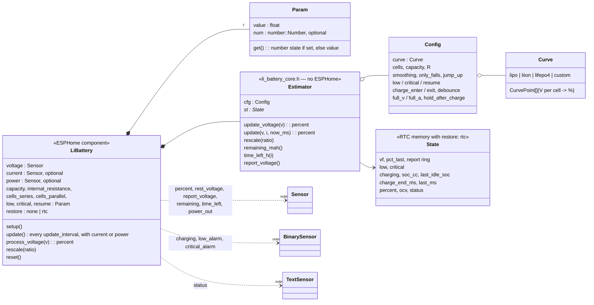
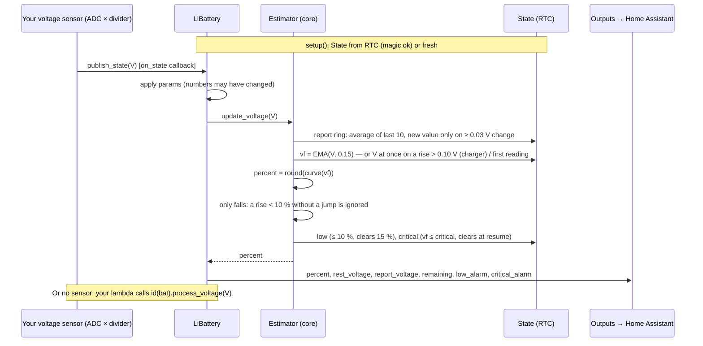
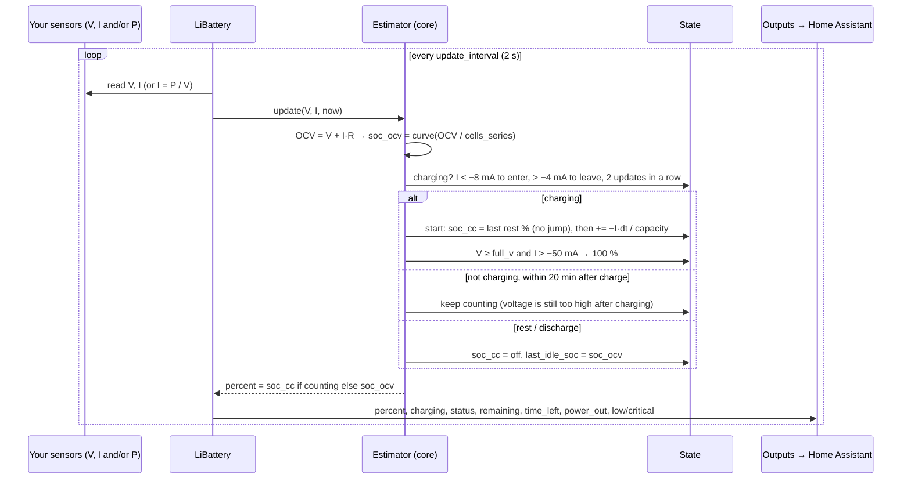
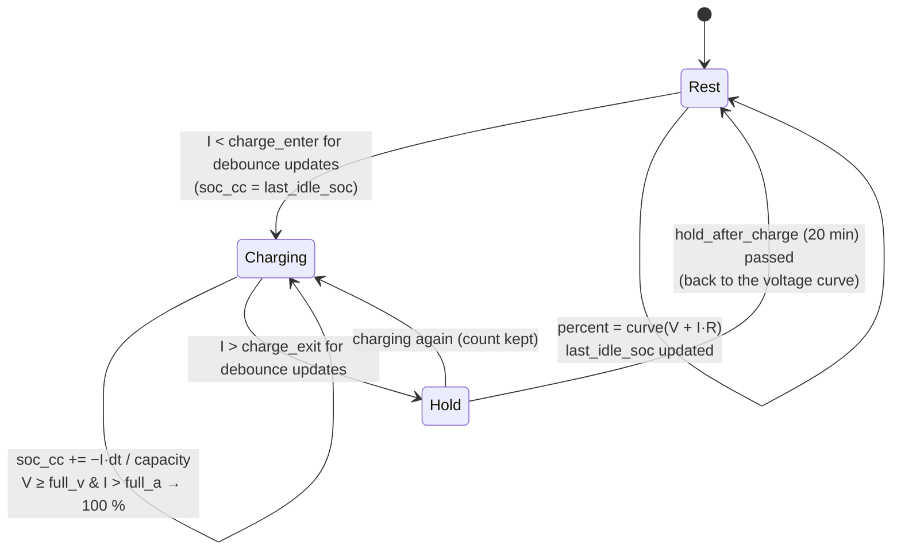
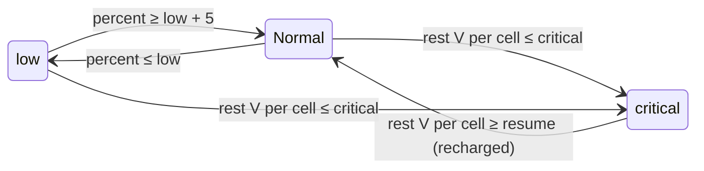

# How li_battery works

**English** · [Русский](how-it-works.ru.md) · [Українська](how-it-works.uk.md)

## Model

The mode follows the inputs: only `voltage` → voltage-only; `current` and/or `power` too → voltage + current.
`chemistry` only picks the curve and the default levels.

## Voltage only

## Voltage + current

## Charging and coulomb counting

## Levels

## Units and signs

| | |
|---|---|
| Voltage | V, whole pack, divider already applied by your sensor |
| Current | A, **+ discharge, − charge** |
| Power | W, same sign |
| Capacity | mAh **per cell** (× `cells_parallel`) |
| Internal resistance | Ω, whole pack |
| critical / resume / full | V **per cell** (rest) |
