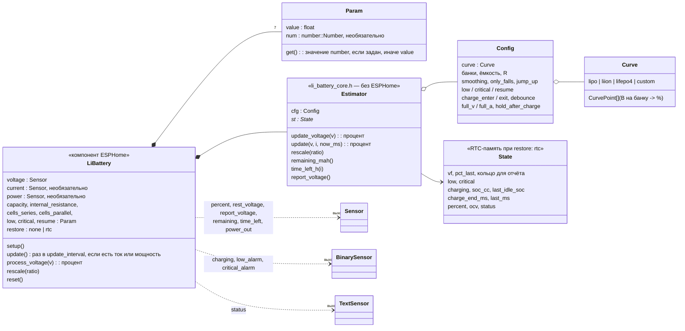
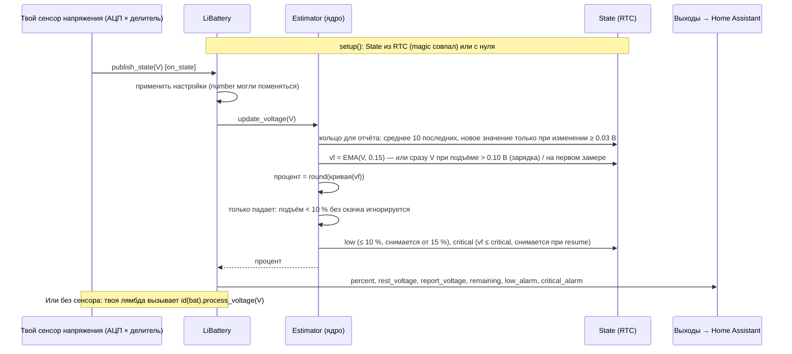
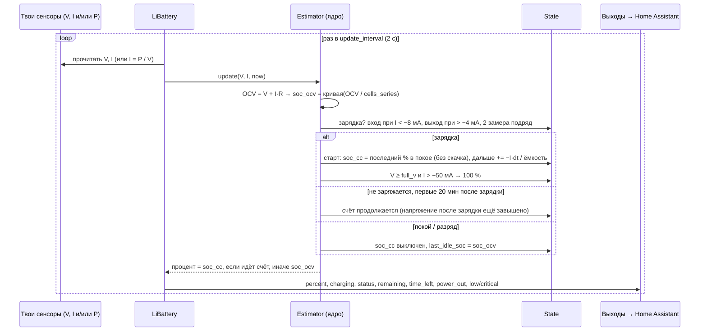
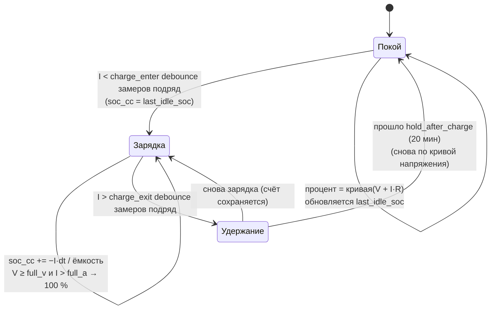
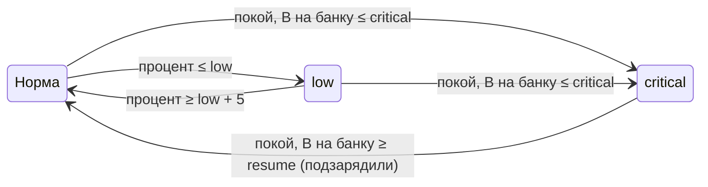

# Как устроена li_battery

[English](how-it-works.md) · **Русский** · [Українська](how-it-works.uk.md)

## Модель

Режим определяется входами: только `voltage` — «только напряжение»; есть ещё `current` и/или `power` —
«напряжение + ток». `chemistry` только выбирает кривую и пороги по умолчанию.

## Только напряжение

## Напряжение + ток

## Зарядка и счёт кулонов

## Уровни

## Единицы и знаки

| | |
|---|---|
| Напряжение | В, вся сборка, делитель уже учтён твоим сенсором |
| Ток | А, **+ разряд, − заряд** |
| Мощность | Вт, тот же знак |
| Ёмкость | мА·ч **на одну банку** (× `cells_parallel`) |
| Внутреннее сопротивление | Ом, вся сборка |
| critical / resume / full | В **на одну банку** (в покое) |
