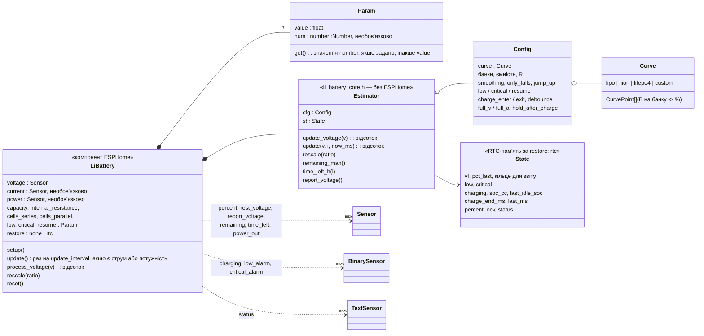
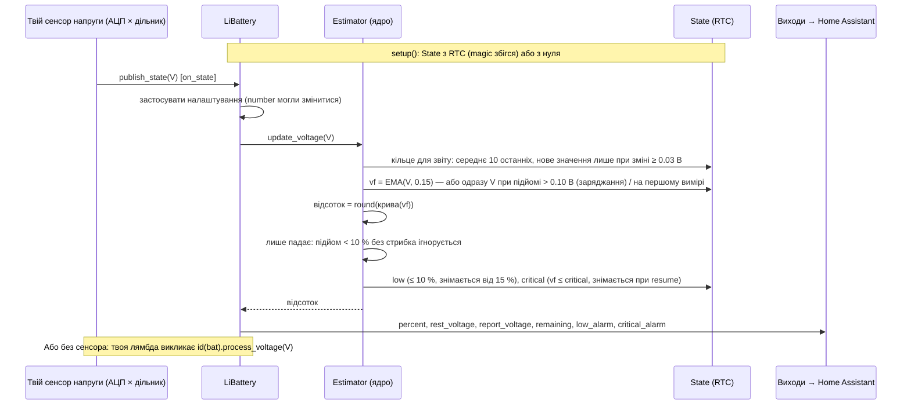
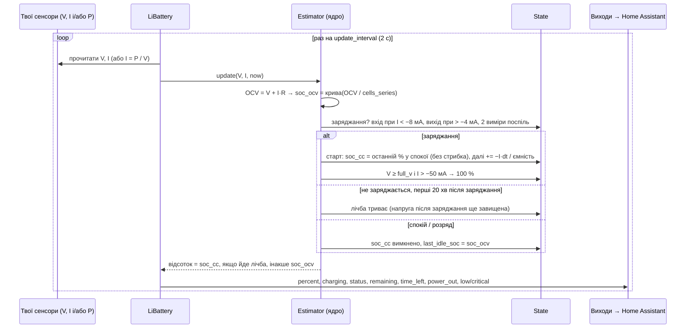
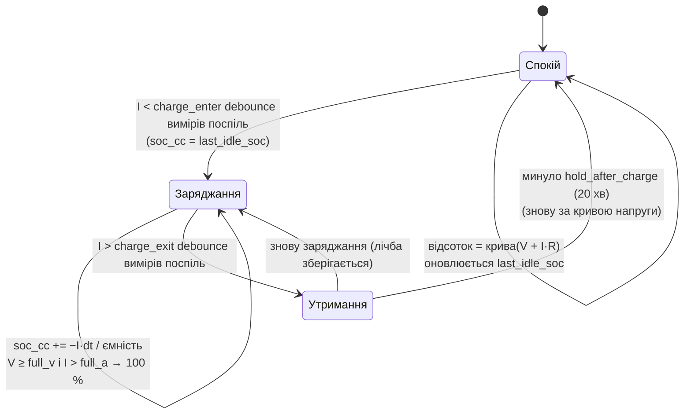
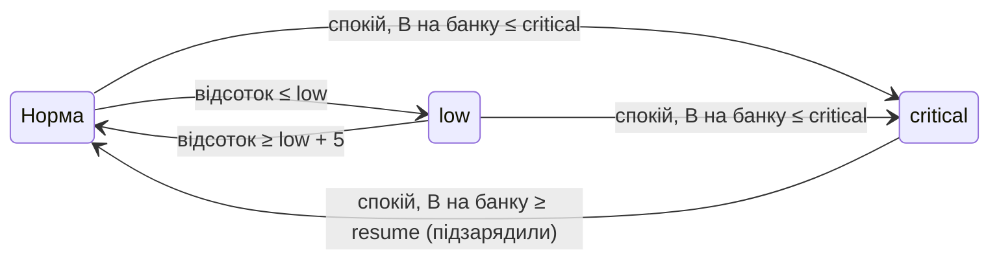

# Як влаштована li_battery

[English](how-it-works.md) · [Русский](how-it-works.ru.md) · **Українська**

## Модель

Режим визначається входами: лише `voltage` — «лише напруга»; є ще `current` і/або `power` —
«напруга + струм». `chemistry` лише обирає криву та пороги за замовчуванням.

## Лише напруга

## Напруга + струм

## Заряджання та лічба кулонів

## Рівні

## Одиниці та знаки

| | |
|---|---|
| Напруга | В, уся збірка, дільник уже враховано твоїм сенсором |
| Струм | А, **+ розряд, − заряд** |
| Потужність | Вт, той самий знак |
| Ємність | мА·год **на одну банку** (× `cells_parallel`) |
| Внутрішній опір | Ом, уся збірка |
| critical / resume / full | В **на одну банку** (у спокої) |
